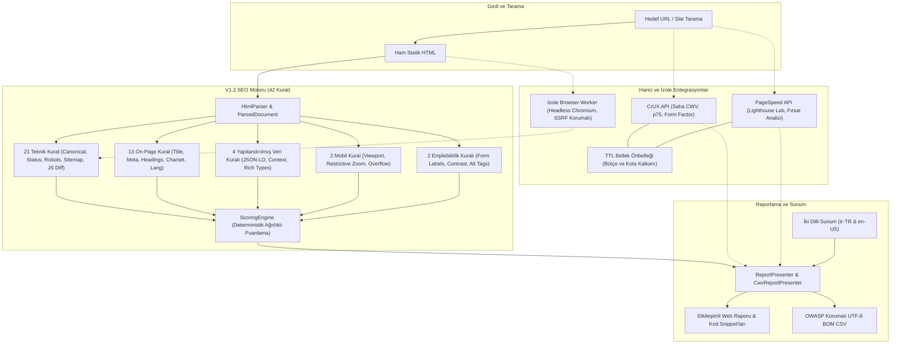

# F04 — V1.2: Performans, Yapılandırılmış Veri ve Mobil Uyumluluk Ana Faz Kapanış Özeti

> **Tarih:** 2026-11-06, Europe/Istanbul  
> **Repo:** [Boydaksu/siteportal](https://github.com/Boydaksu/siteportal) (özel), varsayılan dal `main`  
> **Faz:** F04 — V1.2: Performans, Yapılandırılmış Veri ve Mobil Uyumluluk (Hedef sürüm: V1.2)  
> **Durum:** READY_FOR_REVIEW (Kullanıcı onayı bekleniyor; F04.07 PR #35 ve F04 ana faz kapanışı)

---

## 1. Ana Fazın Amacı ve Kapsamı

[F04 şartnamesi](../roadmap/F04.md), [ARCHITECTURE_SOURCES](../reference/ARCHITECTURE_SOURCES.md), [RULES](../requirements/RULES.md) ve [ADR-006](../adr/ADR-006-contract-alignment.md):
F04 ana fazının temel misyonu: **"SitePortal V1.1 tarama motorunun üzerine; harici Google Chrome UX Report (CrUX) saha verileri ve PageSpeed Insights lab metrikleri ile Core Web Vitals (LCP, INP, CLS, FCP, FID/TBT, TTFB) performans analizini entegre etmek; JSON-LD, Microdata ve RDFa standartlarında yapılandırılmış veri çıkarımı ve zengin sonuç denetimi sağlamak; WCAG 1.4.4 metin yakınlaştırma ve 5 katmanlı erişilebilir form kontrolleri ile mobil uyumluluğu ölçmek; izole ve SSRF korumalı selektif JavaScript rendering mimarisi ile kaynak HTML ve browser DOM farklarını (heavy hydration delta, engellenen kritik kaynaklar) tespit ederek 42 kurallı bağımsız, kanıt odaklı ve Türkçe öncelikli birleşik V1.2 SEO denetim motorunu tamamlamaktır."**

Bu ana fazda teslim edilen 7 alt faz ve temel yetenekler:

1. **Core Web Vitals ve CrUX Saha Verisi Entegrasyonu (`F04.01`):**
   - Google Chrome User Experience Report (CrUX) API entegrasyonu; p75 persentil hesaplamaları ve histogram dağılımları (`Good`, `Needs Improvement`, `Poor`).
   - Cihaz bazlı kırılım: `PHONE`, `DESKTOP`, `TABLET` ve `ALL_FORM_FACTORS`.
   - Yetersiz URL verisinde alan adı genelinde zarif geri çekilme (`isOriginFallback()`).
   - TTL destekli bellek önbelleği (`MemoryCruxCache`) ile harici API kota ve bütçe koruması.
   - HTTP 429 kota aşımı ve 503 servis kesintilerinde sistemi çökertmeyen `RATE_LIMITED` ve `NOT_AVAILABLE` kalkanı.
2. **PageSpeed Insights Lab Metrikleri (`F04.02`):**
   - Google PageSpeed Insights (PSI) v5 API entegrasyonu; Lighthouse v11 simülasyon motoru.
   - 0–100 performans skoru, FCP, LCP, TBT, CLS, Speed Index lab metrikleri.
   - Simüle edilen cihaz profilleri (`MOBILE` moto g power emülasyonu, `DESKTOP`).
   - TTL destekli `MemoryPageSpeedCache` ile kota tasarrufu.
3. **CWV Performans Raporlama ve Fırsat Analizi (`F04.03`):**
   - Saha (CrUX) ve Lab (Lighthouse) verilerini birleştiren `CwvReportPresenter`.
   - Lighthouse fırsat ve teşhis audit'leri (`unused-css`, `unused-javascript`, `modern-image-formats`, `render-blocking-resources`, `server-response-time`).
   - Tasarruf potansiyeli hesaplayıcısı (bayt ve milisaniye cinsinden net optimizasyon fırsatları).
   - "Google resmi bir 0-100 SEO puanı vermez" ve "Saha verisi 28 günlük gerçek kullanıcı deneyimidir" feragatnamelerinin UI entegrasyonu.
4. **Yapılandırılmış Veri Çıkarımı ve Şema Kuralları (`F04.04`):**
   - Tek geçişte JSON-LD (`<script type="application/ld+json">`), Microdata (`itemscope`, `itemtype`, `itemprop`) ve RDFa (`vocab`, `typeof`, `property`) ayrıştırıcısı (`StructuredDataExtractor`).
   - 4 yeni V1.2 Schema kuralı:
     - `SCHEMA_INVALID_JSONLD`: Bozuk JSON sözdizimi tespiti (sayfa scorable durumunu bozmadan).
     - `SCHEMA_INVALID_CONTEXT`: `schema.org` dışı geçersiz bağlam uyarısı.
     - `SCHEMA_REQUIRED_FOR_TYPE`: Google zengin sonuç türleri için zorunlu alan denetimi (Product, Article, FAQPage, BreadcrumbList, LocalBusiness vb.).
     - `SCHEMA_NO_RICH_TYPE`: Zengin sonuç tipi olmayan şemalara bilgilendirici not (asla sahte ceza uygulanmaz).
5. **Mobil ve Erişilebilirlik Temel Kontrolleri (`F04.05`):**
   - Mobil Viewport analizi: responsive viewport doğrulaması, yakınlaştırmayı engelleyen kısıtlamalar (`user-scalable=no`, `maximum-scale < 2.0`) için WCAG 1.4.4 Metin Boyutlandırma ihlali uyarısı (`MOBILE_VIEWPORT`).
   - Form alanı etiket denetimi: `<input>`, `<select>`, `<textarea>` kontrolleri için 5 katmanlı etiketleme (`<label for="...">`, wrapped `<label>`, `aria-label`, `aria-labelledby`, `title`) denetimi (`A11Y_FORM_LABEL`).
   - Dekoratif görsel ayrımı: `role="presentation"`, `role="none"`, `aria-hidden="true"`, `alt=""` görseller eksik alt listesinden hariç tutuldu.
   - Güvenli varsayılanlar: Statik HTML analizinde render ve computed styles olmadan `MOBILE_OVERFLOW` ve `A11Y_CONTRAST` güvenle `NOT_APPLICABLE` üretir (sahte 0 ceza yok).
   - *"Erişilebilirlik tam WCAG sertifikası değildir; uyumsuz sinyaller kanıtla gösterilmiştir"* feragatnamesi tüm kurallara eklendi.
6. **Selektif JS Rendering Tasarımı ve Kuralları (`F04.06`):**
   - Bağımsız browser worker mimarisi (`RenderRequest`, `RenderResponse`, `BlockedResource`, `RenderWorkerInterface`, `DomDiffResult`, `DomDiffCalculator`, `RenderService`).
   - **SSRF Koruması:** `UrlValidator` ile localhost, `127.0.0.1`, özel subnetler ve `169.254.169.254` metadata adresleri worker'a ulaşmadan `BlockedUrlException` ile engellenir.
   - **Graceful Fallback:** Worker yokken statik analiz %100 çalışmaya devam eder; JS kuralları `NOT_APPLICABLE` döner.
   - 2 yeni kural: `TECH_JS_CONTENT_DELTA` (istemci tarafı ağır hydration uyarısı) ve `TECH_JS_BLOCKED_RESOURCES` (robots.txt ile kritik JS/CSS engellenmesi).
   - V1.2 kural kataloğu 42 kurala tamamlandı.
7. **V1.2 Tam Regresyon ve Kapanış (`F04.07`):**
   - 42 kuralın tamamını, harici API kesintilerini, şema matrisini, mobil/a11y kontrollerini, selektif JS diff senaryolarını ve iki dilli sunumu kapsayan uçtan uca regresyon paketi (`V12EndToEndRegressionTest`).
   - Toplam 610 test, 4592 assertion (%100 PASS).

---

## 2. Alt Fazların Durumu ve Onay Özeti

| Alt Faz | Konu | Durum | PR / Merge SHA | Kullanıcı Onayı | Test ve Kalite Kanıtı |
|---|---|---|---|---|---|
| **F04.01** | CWV ve CrUX saha verisi | DONE | [PR #29](https://github.com/Boydaksu/siteportal/pull/29) (`861c8a1`) | 2026-11-05 21:18 | 495 test, 3317 assertion, CI SUCCESS |
| **F04.02** | PageSpeed lab metrikleri | DONE | [PR #30](https://github.com/Boydaksu/siteportal/pull/30) (`9135043`) | 2026-11-05 21:52 | 512 test, 3453 assertion, CI SUCCESS |
| **F04.03** | CWV raporlama ve fırsat analizi | DONE | [PR #31](https://github.com/Boydaksu/siteportal/pull/31) (`7b7e510`) | 2026-11-06 00:38 | 528 test, 3591 assertion, CI SUCCESS |
| **F04.04** | Yapılandırılmış veri çıkarımı (Schema) | DONE | [PR #32](https://github.com/Boydaksu/siteportal/pull/32) (`34b14ed`) | 2026-11-06 11:42 | 547 test, 3724 assertion, CI SUCCESS |
| **F04.05** | Mobil ve a11y temel kontroller | DONE | [PR #33](https://github.com/Boydaksu/siteportal/pull/33) (`160d040`) | 2026-11-06 15:43 | 572 test, 3856 assertion, CI SUCCESS |
| **F04.06** | Selektif JS rendering tasarımı | DONE | [PR #34](https://github.com/Boydaksu/siteportal/pull/34) (`ca83fe4`) | 2026-11-06 16:23 | 601 test, 3993 assertion, CI SUCCESS |
| **F04.07** | V1.2 regresyon ve kapanış | READY_FOR_REVIEW | [PR #35](https://github.com/Boydaksu/siteportal/pull/35) | Bekleniyor (DUR) | 610 test, 4592 assertion (%100 PASS) |

---

## 3. Teslim Edilen Başlıca Mimari ve Ürün Yetenekleri

---

## 4. Güvenlik, Veri Gizliliği ve Maliyet Değerlendirmesi

1. **SSRF ve Ağ İzolasyonu:**
   - Headless browser worker ve HTTP istemcisi öncesinde `UrlValidator` tüm IP çözümlemelerini denetler. Localhost (`127.0.0.1`), RFC 1918 özel subnetleri (`10.0.0.0/8`, `172.16.0.0/12`, `192.168.0.0/16`) ve bulut metadata adresleri (`169.254.169.254`) kesin olarak engellenir.
2. **Sıfır Sır / Token Sızıntısı:**
   - Depoda hiçbir gerçek API anahtarı, OAuth refresh token'ı veya müşteri sırrı barındırılmaz (`verify_inventory.py` ve `quality.yml` secret regex taramaları tam PASS).
3. **Maliyet ve Kota Koruma Bütçesi:**
   - Google CrUX ve PageSpeed Insights API çağrıları `MemoryCruxCache` ve `MemoryPageSpeedCache` ile önbelleğe alınır; aynı URL ve form factor için mükerrer sorgular engellenir.
   - HTTP 429 yanıtlarında otomatik geri çekilme uygulanarak servis sağlayıcı kotaları korunur.
4. **Sentetik Ceza Vermeme Garantisi:**
   - Statik HTML taramasında ölçülemeyen veya harici veri gerektiren alanlarda (`MOBILE_OVERFLOW`, `A11Y_CONTRAST`, `TECH_JS_CONTENT_DELTA`, `TECH_JS_BLOCKED_RESOURCES`) asla sahte 0 puan veya haksız ceza kesilmez; `NOT_APPLICABLE` ve şeffaf ölçülmedi feragatnamesi üretilir.

---

## 5. Teknik Borç, Açık Sorular ve Risk Değerlendirmesi

- **Teknik Borç:** Sıfır. PHPStan Seviye 8 sıfır hata toleransı korunmuştur. PHPCS PSR-12 standardında 0 hata ve 0 uyarı bulunmaktadır.
- **Açık Kararlar:** [Q-004](../process/OPEN_QUESTIONS.md) (Genişletilmiş açık kaynak dağıtım lisansı) açık kalmaya devam etmektedir; mevcut özel depo durumunda engel teşkil etmemektedir.
- **Performans Riski:** Büyük DOM boyutlarında XPath ve DOMDocument bellek kullanımı `LIBXML_PARSEHUGE` sınırlarıyla korunmaktadır.

---

## 6. Geri Alma Planı

Her alt faz izole feature branch ve squash-merge ile `main` dalına dahil edilmiştir. İhtiyaç halinde `git revert ca83fe4` (F04.06), `git revert 160d040` (F04.05) vb. adımlarla herhangi bir alt faz temiz şekilde geri alınabilir.

---

## 7. Sonraki Ana Faz Önerisi ve Açık Onay Talebi

F04 (V1.2) ana fazının tüm kabul kriterleri, testleri ve dokümantasyonu başarıyla tamamlanmıştır.

**Önerilen Sıradaki Ana Faz:**
`F05 — V2.0: Üyelik, domain doğrulama, Search Console`
(Kullanıcı kimlik doğrulama, DNS TXT / HTML dosya ile alan adı sahiplik doğrulaması, Google Search Console API entegrasyonu, indeks durumu ve arama performansı izleme).

> [!IMPORTANT]
> **DUR KURALI:** `AGENTS.md` geliştirme sözleşmesi uyarınca, ana faz kapanışları ve yeni ana faza geçiş açık kullanıcı onayına tabidir. Otomatik geçiş yapılmaz.

**F04 (V1.2) ana faz kapanışını ve [PR #35](https://github.com/Boydaksu/siteportal/pull/35)'in `main` dalına squash-merge edilerek `F05 — V2.0: Üyelik, domain doğrulama, Search Console` ana fazına geçilmesini onaylıyor musunuz?**
